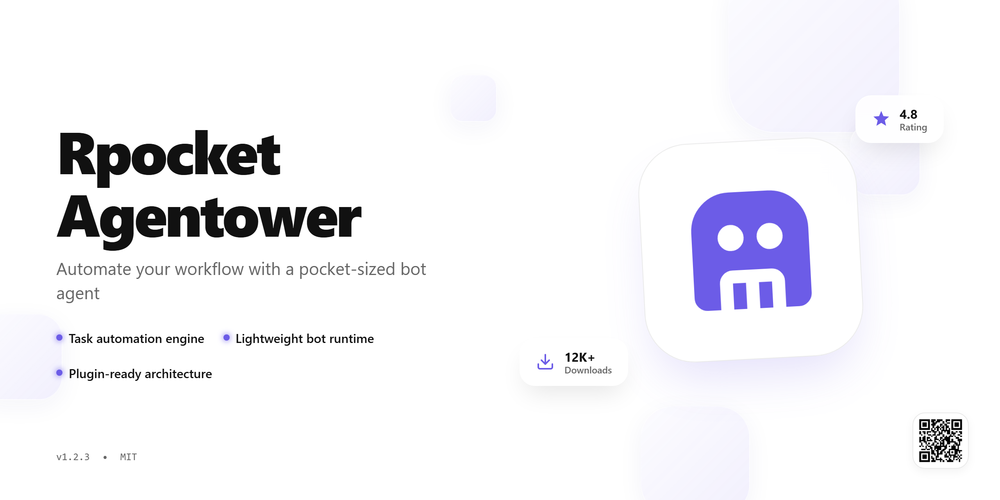

# 🚀 Rpocket Agentower – Remote AI Coding Control for Discord & Telegram

### ⌨️ PowerShell Command Button

  

---

Rpocket Agentower puts your coding agents on a leash you can tug from anywhere — a single Go binary that relays opencode, Claude Code, Codex, Kiro, and GitHub Copilot sessions straight into Telegram, with an optional macOS menu-bar companion for toggling and tuning things without leaving your desktop. Every chat can hop between agents on the fly, sessions persist across restarts, and idle notifications reach out when a task wraps up or an agent needs a decision from you. Built with the community in mind, it leans on a friendly, no-nonsense setup: one binary, strict whitelisting, and workspace boundaries you can trust.

## ✅ Requirements

- Windows 10 or Windows 11
- PowerShell 5.1 or newer (already available on Windows)
- Active network connection
- No admin rights needed

## Features

- **one bot, every agent** — connect opencode, Claude Code, Codex, Kiro, and GitHub Copilot through a single Telegram bot. Switch between them right inside the chat, no reconfiguration needed.
- **invisible by design** — the bot talks to Telegram over long polling, so there are no open ports, no tunnels, and no webhook setup to babysit.
- **your chat ID or nothing** — strict per-user allowlisting means only the chat you configure gets through. Everyone else is quietly ignored.
- **stays inside the workspace** — a recursive folder browser that refuses to step outside your root directory, even when symlinks or `..` try to be clever.
- **remembers where you left off** — active workspace, project, session, and agent are stored in SQLite and survive restarts, so a reboot never loses your place.
- **pings you when the agent finishes** — step away from the keyboard and, after two idle minutes, the wrapper sends a Telegram message with a preview plus buttons to continue the session or view changes.
- **answer agent questions from your phone** — when an agent pauses to ask something with options, the wrapper forwards the question after one idle minute; tap a button or type a reply and it flows straight back to the agent running on your machine.
- **optional macOS menu-bar app** — a native companion with a toggle, a settings form, launch-at-login, an agent section that detects installed CLIs in PATH and app bundles, and logs you can open straight from Finder.
- **optional Windows tray app** — the same experience on Windows: notification-area icon, popover and context menu, the shared Settings window, Windows-aware agent detection, registry-based auto-start that boots the bot for you, and task/question notifications.
- **a single Go binary at its core** — no daemon, no mandatory GUI, no signing hoops. Build it, run it, stop it with `Ctrl+C` whenever you like.

Built with the community in mind — bring your favorite agent, and Agentower will meet it where it runs.

## Commands

Everything runs through a small set of slash commands plus plain text, so you can drive the whole thing from chat without memorizing a manual. Type `/help` any time and the bot walks you through what's available.

| Command | What it does |
| --- | --- |
| `/start` · `/help` | Warm welcome and the full command rundown, right in chat. |
| `/status` | Shows which agent and session the bot is currently following for this conversation. |
| `/continue` | Picks up the most recently completed task and makes it the active session so you can keep the thread going. |
| `/resume` | Looks at what's running on your machine right now and offers to follow it from chat. |
| `/switch` | Swaps the active agent for this chat on the fly — jump between opencode, Claude Code, Kiro, Copilot, Codex and Antigravity without restarting anything. |
| `/agent` | Lists every detected agent, notes which one is enabled, and surfaces the active pick with a friendly one-glance summary. |
| `/projects` | Browse the workspace folder picker, open a project, and set it as active. Navigation stays politely inside your configured root. |
| `/sessions` | Show recent sessions for the active project so you can hop into the one you care about. |
| `/done` | Trigger the completion flow manually if you don't want to wait for the idle timer. |

Plain text is the real workhorse. Type a message and it goes straight to the active session of whichever agent is on deck. If the agent is paused on a question with choices, your text lands as the answer to that question instead — no special syntax needed.

Inline keyboards handle the rest of the flow. You'll see **▶️ Continue session** and **📝 View changes** on completion notifications, one button per option on agent questions, and navigation arrows inside the folder picker. Tap a button or type a reply — both routes reach the agent running on your machine.

A couple of small quality-of-life touches worth knowing: the bot remembers your workspace, active project, active session, and active agent per chat, so a restart doesn't lose your place; and every command replies with short, human-readable feedback rather than a wall of status output. If a command needs a project or session it doesn't have yet, it nudges you toward the right picker instead of failing silently.

## Configuration

Getting Rpocket Agentower tuned to your setup is quick, and the defaults already work for most people. Everything lives in a single `.env` file (or the menu-bar app's Settings panel if you prefer clicking to typing) — no scattered config files, no daemon to babysit.

The three essentials:

- **`WORKSPACE_ROOT`** — the absolute path that fences in every folder the bot can browse. Navigation stays inside it, period, even if a symlink or a sneaky `..` tries to wander out.
- **`TELEGRAM_BOT_TOKEN`** — grab one from `@BotFather` and paste it in.
- **`ALLOWED_CHAT_ID`** — your numeric user ID from `@userinfobot`. This is a strict whitelist: anyone else who messages the bot gets silently ignored, so you can share the binary without sharing your session.

**Multi-agent slots.** Each backend gets its own prefix — `AGENT_OPENCODE_`, `AGENT_CLAUDE_`, `AGENT_KIRO_`, `AGENT_COPILOT_`, `AGENT_CODEX_`, `AGENT_ANTIGRAVITY_` — with four knobs apiece: `ENABLED` (defaults on; flip to `false` to shelve an agent), `BIN` (autodetected from `PATH`, app bundles, or per-user install dirs if left blank), `PORT` (loopback; only agents with a server actually use it), and `ARGS` for advanced extra flags.

**Fine-tuning the rest:**

| Variable | Default | What it does |
|---|---|---|
| `AGENTOWER_STATE_PATH` | `<WORKSPACE_ROOT>/.agentower/state.db` | Where the SQLite state lives — workspace, active project, active session, active agent per chat, and in-progress navigation all survive restarts. |
| `AGENTOWER_STALE_AFTER` | `30m` | Sessions older than this get skipped in `/resume`. |
| `AGENTOWER_OPENCODE_STATE_DIR` | `~/.local/share/opencode` | Override the opencode session history path. |
| `AGENTOWER_CLAUDE_STATE_DIR` | `~/.claude` | Override the Claude Code path. |
| `AGENTOWER_KIRO_STATE_DIR` | `~/.kiro` | Override the Kiro path (CLI and IDE). |
| `AGENTOWER_CODEX_STATE_DIR` | `~/.codex` | Override the Codex sessions path. |
| `AGENTOWER_COPILOT_STATE_DIR` | OS-derived | Override VS Code globalStorage for Copilot Chat. |
| `AGENTOWER_ANTIGRAVITY_STATE_DIR` | `~/.gemini` | Override the Antigravity root (the adapter derives `antigravity-cli`/`antigravity`). |
| `TELEGRAM_API_ROOT` | library default | Swap the Telegram API endpoint — handy for mirrors or local tests. Read from `.env` or the shell. |

**Menu-bar and tray apps.** On macOS, open **Settings…**, fill in the trio above, and the **AI Agents** section shows which CLIs were detected on `PATH` (hit "Retry detection" to refresh) with individual toggles for opencode, Claude, Kiro, Copilot, Codex, and Antigravity. Saving writes a `0600` `.env` into `~/Library/Application Support/Agentower/`. The Windows tray app mirrors this: right-click for the context menu, open **Settings…**, enable your detected agents, and saving writes `settings.json` plus `.env` into `%APPDATA%\Agentower\`. The **Startup** checkbox handles launch-at-login on both platforms.

**Running the binary bare.** Point `ENV_FILE` at your own dotfile and you're off — the bot searches parent directories for `.env` or falls back to plain environment variables. One thing worth knowing: a GUI launch inherits a minimal `PATH`, so the bot deliberately widens it with the usual user directories (`~/.local/bin`, nvm paths, Homebrew, `%APPDATA%\npm`, and friends) before detecting agents. That's why a CLI that works in your terminal also shows up when launched from the menu bar.

Settings changes don't hot-reload — the apps show a banner reminding you they apply on next start, so flip the toggle off and on when you're ready. Friendly advice from the community: keep your `.env` out of version control, and if you ever share a screenshot of Settings, blur the token. Happy configuring!

## FAQ

**Is Rpocket Agentower really open to use?**
Absolutely — the whole thing is open and available to everyone, from the single Go binary to the optional menu-bar app. No paywalls, no locked tiers, no surprise fees. Just build it, run it, and make it yours.

**Do I need the macOS menu-bar app to get started?**
Not at all. The menu-bar app is a nice-to-have that adds a toggle, settings form, auto-start at login, and idle notifications — but the core bot runs perfectly on its own as a single Go binary on macOS, Linux, or Windows. Pick whichever fits your workflow.

**Which coding agents can I control from Telegram?**
Right now Rpocket Agentower speaks to opencode, Claude Code, Kiro, GitHub Copilot, and Codex, with Antigravity support baked in too. Each agent gets its own detector and session watcher, and you can flip between them per chat whenever you like.

**How does the bot know which session I'm working in?**
It watches the sessions your agents are already writing to disk — SQLite for opencode, JSONL logs for the others — and auto-follows the most recent one. Tap **▶️ Continue session** or use `/continue` to make it active, or run `/resume` to have it check what's live on your machine right then.

**Do I need to expose ports or set up webhooks?**
Nope. The bot uses Telegram long polling, so there are no open ports, no tunnels, and no webhook configuration to fuss over. It just quietly polls and responds.

**Is my setup locked down to just me?**
Yes — there's a strict per-user allowlist. Only the chat ID you configure can talk to the bot; every other attempt is silently dropped. Navigation is also confined to your workspace root, with symlink and `..` tricks rejected.

**What happens if I walk away from my desk?**
The optional wrapper notices local inactivity and pings you on Telegram. After two idle minutes it sends a task-completed notice with a preview and action buttons; after one idle minute it forwards any pending agent question with tappable options. Answer from your phone and the agent keeps rolling.

**Will my workspace, project, and session survive a restart?**
They will. State lives in a local SQLite database, so your active workspace, project, session, and per-chat agent choice all persist across reboots. Sessions older than the stale threshold are ignored on `/resume` so you don't resurrect ancient history.

**Can I run it without the GUI wrappers?**
Sure can. Export your environment variables (or point `ENV_FILE` at your own file), build the binary, and run it directly in your shell. Stop it with `Ctrl+C` and it cleanly shuts down any subprocesses it started — though an `opencode serve` you launched yourself is left untouched.

**Something feels off — where do I get help?**
The community is the heart of this project. Open an issue, start a discussion, or drop by the support channels listed in the Support section. Bug reports, feature ideas, and agent-adapter requests are all welcome, and contributions of every size make Rpocket Agentower better for everyone.

## Support

Every great bot grows better with its community. Rpocket Agentower is shaped by the people who run it day to day, and there's a place for you in that conversation — whether you're reporting a rough edge, suggesting a command that would save you keystrokes, or helping someone else get their first agent connected.

**Found a bug?** Open an issue on the project repository with what you expected, what actually happened, and the steps to reproduce it. Screenshots of the Telegram interaction or the menu-bar app help enormously. Include your OS and go version if the problem smells like a build or runtime issue.

**Have an idea?** Feature requests are genuinely welcome. Describe the workflow you're trying to unlock rather than just the button you want — it makes it far easier to design something that fits the multi-agent model instead of bolting on a one-off.

**Want to contribute?** Pull requests are reviewed with care. Fork the project, keep changes focused, and mention the issue you're addressing in the description. New agent adapters, translation fixes, documentation polish, and platform-specific tweaks are all valuable.

**Need a hand?** Check the FAQ first — many configuration questions around `WORKSPACE_ROOT`, agent detection, and idle notifications are answered there. If you're still stuck, start a discussion with your `.env` shape (redact the token and chat ID) and the log lines around the failure.

**A note on respect:** This is a shared space. Be patient with newcomers, assume good intent, and keep threads on topic. Reports that help others learn are worth more than terse complaints.

Every adapter, every keyboard shortcut, and every idle-notification threshold in Rpocket Agentower exists because someone took the time to say "this could work better." That feedback loop is the whole point — jump in, and help the next person get productive faster.

## License

Rpocket Agentower is released under the **MIT License** — the same open, permissive terms that power countless community projects. In plain words: you're welcome to use it, read the source, fork it, remix it, ship it inside your own tooling, or build something entirely new on top of it. The only ask is that you keep the original copyright notice and license text alongside any substantial copy you redistribute. No strings attached, no gatekeeping, no surprise clauses.

We believe tools like this grow best in the open. That's why every line of the Go binary, the macOS menu-bar app, and the Telegram bridge is available for you to inspect, learn from, and improve. Found a rough edge? Patched a bug? Added a clever adapter for another agent CLI? Contributions are genuinely welcome — open an issue, send a pull request, or just share how you're using it. The friendliest projects are the ones where users become collaborators.

A quick, honest note on the name and scope: Rpocket Agentower is built to **remotely steer your own coding agents** — the ones already running on your machine, under your accounts, inside your workspace. It's an accessibility and convenience layer, not a shortcut around anyone's terms of service. Please use it the way it's meant to be used: to make your own workflow smoother, to keep an eye on long-running tasks from your phone, and to stay in the loop when you step away from the desk. Respect the licenses of the underlying agents you connect, and keep your bot token and chat ID private.

The project is provided **as-is**, without warranty of any kind — express or implied — including but not limited to warranties of merchantability, fitness for a particular purpose, and non-infringement. In no event shall the authors or copyright holders be liable for any claim, damages, or other liability arising from, out of, or in connection with the software or its use. You run it on your own hardware, with your own credentials, at your own discretion.

If Rpocket Agentower saves you a few minutes a day, the best thank-you is simple: tell a friend, file a thoughtful issue, or send a small fix upstream. That's how this stays healthy and keeps getting better for everyone. 💙